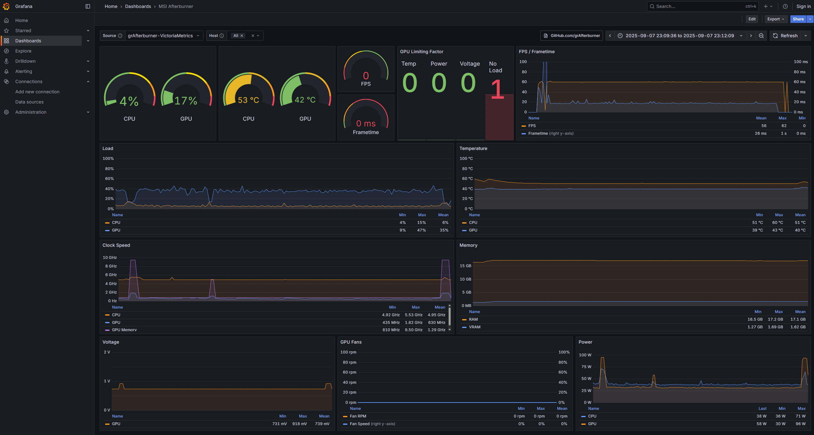
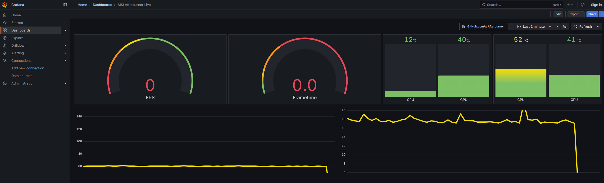
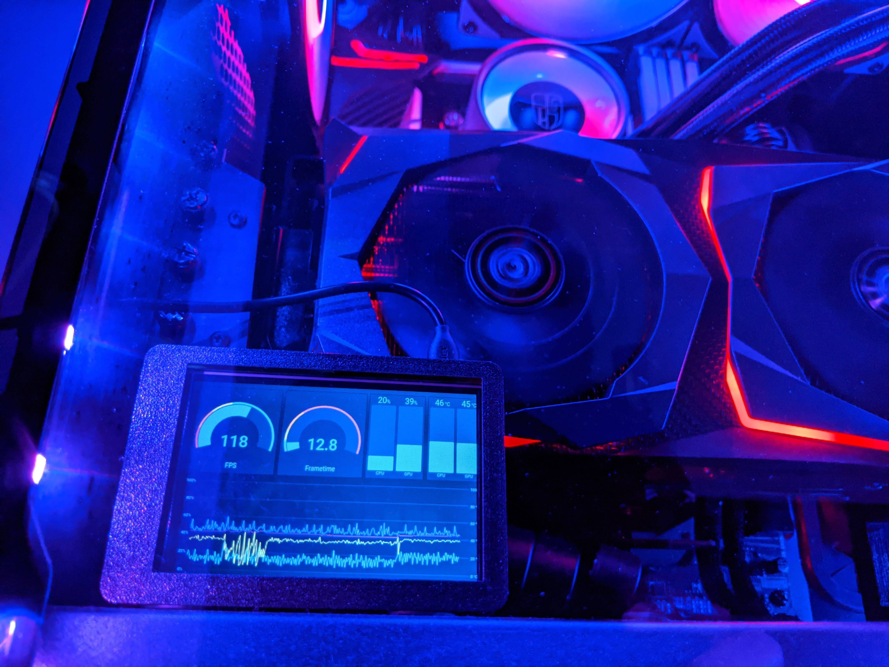

# grAfterburner

<p align="center"><a href="https://grafana.com"></a>  <a href="https://www.msi.com/page/afterburner"></a> <br>Monitor your PC in style with Grafana and MSI Afterburner</p>




### Why?

- A lot of people already use MSI Afterburner for it's GPU overclocking functionality, as well as coming with the excellent RTSS for frametime monitoring and on-screen-display. It also adds negligible load on your CPU.
- Since I have a single monitor set-up, I wanted something I could display on my [Raspberry Pi 3B+](https://www.raspberrypi.org/products/raspberry-pi-3-model-b-plus/) which I had a small [3.5" Display](https://learn.adafruit.com/adafruit-pitft-3-dot-5-touch-screen-for-raspberry-pi/overview) for, and I did not want to run yet another monitoring software just for that. Also, very few software can monitor the frame-time during games.
- As MSI Afterburner has an additional Remote Server component, I wanted to find a way to get that displayed in a nice dashboard, which led me to this.
- [Interactive Snapshot Demo](https://snapshot.raintank.io/dashboard/snapshot/Z5mCjhrfHn8bTYr7Ld3YgbRoNAvbl6We) (not 100% accurate as some features are not supported)
- The Full Grafana dashboard can be found [here](https://grafana.com/grafana/dashboards/12021) to import into your existing instance, this fetches stats from a database.
- The Live version of the Grafana dashboard can be found [here](https://grafana.com/grafana/dashboards/24041) to import into your existing instance, this has stats streamed directly to Grafana without any database.

### Components

- [MSI Afterburner](https://www.msi.com/page/afterburner): provides a detailed overview of your hardware, and also allows graphics card overclocking. Includes [RTSS](https://www.guru3d.com/files-details/rtss-rivatuner-statistics-server-download.html) which also provides an on-screen-display during games.
- [MSI Afterburner Remote Server](https://www.msi.com/page/afterburner): serves up an HTTP endpoint with data from MSI Afterburner in an XML format.
- [Telegraf](https://github.com/influxdata/telegraf): an agent which collects metrics periodically and provides mechanisms to store the values in a variety of ways. Used to perform HTTP requests to the MSI Afterburner endpoint and store the data in a database.
- [VictoriaMetrics](https://github.com/VictoriaMetrics/VictoriaMetrics): a time-series database that stores numeric time-series data and provides an API to access it. Stores the data from the collecting agent.
- [Grafana](https://grafana.com/): allows you to query, visualize, alert on and understand your metrics and create your own dashboards. Visualizes the data stored in various sources, and can have data streamed directly to it.
- [Docker](https://www.docker.com/): tool for building and running applications in containers. Allows you to start up the collection agent, database, and dashboard in one command without needing to think about dependencies or configurations.

### Requirements

- For the PC you want monitored, you will need these (Windows only)
  1. [MSI Afterburner](https://www.msi.com/page/afterburner) (it will ask you about RTSS as well during installation which you need for FPS / Frametime information)
  2. [MSI Afterburner Remote Server](https://www.msi.com/page/afterburner) (does not install but just has an executable, appears to have been removed from this page, you may have to search around to find it, CNET, Softpedia, and TechSpot appear to have some version of it, but I cannot verify or guarantee the authenticity of these versions and whether or not they work) (I have used and tested with version `1.2.0.0` of the `exe` and version `1.1.0.0` of the `.dll`)
- For the monitoring setup (can be on the same PC or a separate one, Windows / macOS / Linux)
  1. [Docker](https://docs.docker.com/install/) (and [Docker Compose](<[https://docs.docker.com/compose/install/](https://docs.docker.com/compose/install/)>))

### Installation

1.  Download and install the requirements listed in the above section and make sure that they are running.
2.  [Clone](https://help.github.com/en/github/creating-cloning-and-archiving-repositories/cloning-a-repository) [this repository](https://github.com/RafhaanShah/grAfterburner.git) on the PC that you want the monitoring setup to run on (the one with Docker), or download it as a zip from the [releases page](https://github.com/RafhaanShah/grAfterburner/releases) and extract it to a folder.

### Configuration

1. **MSI Afterburner:**
   - Open MSI Afterburner by clicking the tray icon in the bottom right of Windows
   - Go into Settings -> Monitoring
   - Press the check mark next to every metric that you want monitored (e.g.: GPU Usage)
   - Press OK
2. **MSI Afterburner Remote Server:**
   - This application only has a tray icon so right click it to view the options
   - Go into security and set a password of your choice
   - Go into HTTP Listener and change the port if you wish to change the default of 82
   - Also note the IP address it shows, you will need it in the next step
   - Press restart server when you are done
3. **Monitoring Configuration:**
   - Open the cloned repository folder
   - Find and open [`telegraf/telegraf.conf`](telegraf/telegraf.conf)
   - Edit the `urls` line under `[[inputs.http]]` to be the [`Local IP`](https://lifehacker.com/how-to-find-your-local-and-external-ip-address-5833108) address and the port of your PC (the one with MSI Afterburner running) which you configured in the previous step, e.g.: if my PC's IP address is 192.168.1.123 and I set port 82, the line should be:
     ```
     urls = ["http://192.168.1.123:82/mahm"]
     ```
     (You can also use your PC's hostname instead of the IP if you have local hostname resolution working on your network)
   - Edit the `password` line to have the password you set in step 3, e.g.: if my password is `abcd1234` the line should be:
     ```
     password = "abcd1234"
     ```
   - Save and close the file
4. **Optional Configurations:**
   - Edit [`docker-compose.yaml`](docker-compose.yaml) under `grafana > ports` to change the port Grafana runs on from `8025` to something else (leave the `3000`).
   - Edit [`docker-compose.yaml`](docker-compose.yaml) under `grafana > env` if you want to change login configuration for Grafana and any other [environment variables](https://grafana.com/docs/grafana/latest/installation/configuration/#configure-with-environment-variables).
   - If you do not want the services to start on the boot-up of your system remove the lines in [`docker-compose.yaml`](docker-compose.yaml) that say `'restart: always'`.
   - If you wish to change how often MSI Afterburner polls your hardware for new data, open MSI Afterburner, Settings -> Monitoring -> Hardware Polling Period.
   - You will probably also want to change how often new data is fetched as well, so open [`telegraf/telegraf.conf`](telegraf/telegraf.conf) and edit lines related to `interval`.
   - If you do not need / want long term data, you can remove `victoriametrics` section from [`docker-compose.yaml`](docker-compose.yaml) and `[[outputs.influxdb_v2]]` section from [`telegraf/telegraf.conf`](telegraf/telegraf.conf) - this will only stream data directly to Grafana, so you will only have "live" data and not historical data.

### Running

1.  Open command prompt / powershell / any terminal in the repository folder
2.  Run this command to start up the monitoring services:
    ```
    docker-compose up -d
    ```
3.  To open the Grafana and view the dashboard, you will need to know the local IP address of the computer running the services, e.g.: if the computer I am running the services on has a Local IP address of `192.168.1.20`, then I will need to type into my web browser:
    ```
    http://192.168.1.20:8025
    ```
    (if you changed the port Grafana runs on, then you will need to replace `8025` with that port)
4.  The dashboard and data source will already be set up but you can modify all of it to suit your needs. Auto refresh and time range options are in the top right corner, and more information on dashboards can be found [here](https://grafana.com/docs/grafana/latest/features/dashboard/dashboards/).
5. There will be 2 dashboards provided by default, the `Full` dashboard includes more metrics and fetches data from the database. The `Live` dashboard has data streamed directly from the collection agent, so there will be less latency, but you can only see the current data. Both dashboards can be modified to include / exclude any data.
6.  If you wish to stop the services use the following command:
    ```
    docker-compose stop
    ```

### Notes

- If your PC does not have a Static Local IP, you should [set it](https://www.howtogeek.com/howto/19249/how-to-assign-a-static-ip-address-in-xp-vista-or-windows-7/) to have one so that [`telegraf/telegraf.conf`](telegraf/telegraf.conf) will not point to the wrong IP every time your PC gets a new Local IP address. Alternatively you can use the PC's hostname if you have local hostname resolution working on your network.
- I'd recommend running the monitoring on a different PC to your main one, so as to not affect it's performance.
- The number of graphs and the refresh rate will affect the amount of CPU usage by the database.
- SD cards used in Raspberry Pi's are not really meant to be [constantly written](https://domoticproject.com/extending-life-raspberry-pi-sd-card/) to, and even though the database may be very efficient with it's storage, you may want to look into booting off an SSD or setting the storage [volume](https://docs.docker.com/compose/compose-file/#volumes) to be on an external drive.
- If you are using a small screen (like a 3.5" Raspberry Pi Screen), you may need to adjust the zoom level of the dashboard in your browser to be able to fit more graphs at once.
- For monitoring more than 1 PC, you need to modify [`telegraf/telegraf.conf`](telegraf/telegraf.conf) and either add another IP in `urls` or add a whole new `[[inputs.http]]` section depending your preference. You will likely need to update the dashboards to fit your preference as well as it is designed to show a single host at a time.

### Troubleshooting

- Verify MSI Afterburner Remote Server is working: go to `http://192.168.1.123:82/mahm` (where `192.168.1.123` is the IP address of your PC running MSI Afterburner) in a web browser (try it on a browser that is not on the PC you are running MSI Afterburner on). You should get a pop-up asking for a username and password, use MSIAfterburner and the password you set, and verify that there is XML data visible, like [this](https://gist.github.com/joar/2a91ff54718e58011f86).
- Verify the data source in Grafana: click the cog on the left for settings. On the data sources page there should be an entry already there. Click on this and click save and test. It should have a success message.
- Go to Grafana > Explore, select Grafana as the data source and Live Measurements as the Query Type, and `stream/msi_afterburner` should appear under Channel.
- Go to Grafana > Drilldown > Metrics, select the correct data source to see if Grafana is finding any data from the database.
- Check the monitored metrics you set up in MSI Afterburner during step 1, the default provided dashboard uses: GPU temperature, GPU usage, Memory usage, Core clock, Memory clock, GPU voltage, Fan speed, Fan speed 2, Fan tachometer, Fan tachometer 2, Temp limit, Power limit, Voltage limit, No load limit. CPU temperature, CPU usage, CPU clock, CPU power, RAM usage, Framerate, Frametime. You do not need to have all these, and you can make your own dashboards, but the one that is already set up uses these metrics.
- Check the [logs](https://docs.docker.com/config/containers/logging/) of the docker containers to see if there are any log messages that may help, look in [`docker-compose.yaml`](docker-compose.yaml) and [`telegraf/telegraf.conf`](telegraf/telegraf.conf) for comments that can help debug.



### Alternatives / Similar Tools
- [gamergraf](https://github.com/ragesaq/gamergraf)
- [InfluxDB Importer](https://gist.github.com/veteran29/962d096d70adaed93ad0007742a5f21d)
- [Prometheus Exporter](https://github.com/kennedyoliveira/prometheus-msi-afterburner-exporter)
